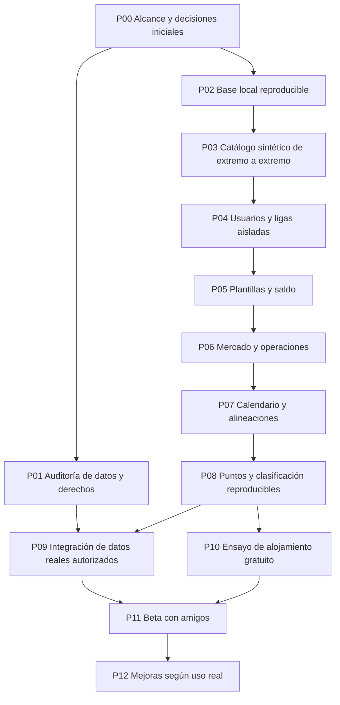

# Basket Fantasy

Arquitectura y plan de construcción incremental de un fantasy de Liga Endesa. Alcance confirmado: liga privada, pruebas en local y temporada 2026/27.

**Estado:** planificación; todavía no hay aplicación ni auditoría autenticada del proveedor. Presupuesto autorizado: **0 € de servicios**. Documento inicial: 29 de septiembre de 2026.

## Punto de entrada

1. Consultar [estado y siguiente paso](docs/00-estado.md).
2. Revisar [producto y decisiones pendientes](docs/01-producto.md).
3. Seguir el [mapa de entregas](docs/05-pipelines.md), en orden de dependencias.
4. Para implementar, consultar [arquitectura](docs/02-arquitectura.md), [modelo de datos](docs/03-datos.md) y [seguridad y operación](docs/06-seguridad-operacion.md).
5. Antes de integrar datos reales, completar la [auditoría del proveedor](docs/04-auditoria-proveedor.md).

Las tecnologías seleccionadas son una propuesta técnica concreta. Las reglas de juego sin respuesta están señaladas como pendientes: no se convierten en requisitos por aparecer como opciones.

## Mapa general

Si datos o permisos fallan, el desarrollo con datos sintéticos puede llegar hasta P10. P11 con ACB real requiere resolver ambos. No se cambiará de competición ni se contratarán servicios sin una decisión del usuario.

## Documentos de trabajo

| Documento | Qué resuelve |
| --- | --- |
| [00 · Estado](docs/00-estado.md) | Qué está hecho, qué falta y por dónde retomar |
| [01 · Producto](docs/01-producto.md) | Alcance, funcionalidades, preguntas y reglas |
| [02 · Arquitectura](docs/02-arquitectura.md) | Tecnologías, módulos, flujos y estructura prevista |
| [03 · Datos](docs/03-datos.md) | Entidades, integridad, historial, dinero y puntuación |
| [04 · Auditoría](docs/04-auditoria-proveedor.md) | Disponibilidad, calidad, frecuencia, derechos y alternativas |
| [05 · Pipelines](docs/05-pipelines.md) | Entregas pequeñas, dependencias y criterios de aceptación |
| [06 · Seguridad y operación](docs/06-seguridad-operacion.md) | Permisos, pruebas, despliegue, copias y recuperación |
| [07 · Decisiones y fuentes](docs/07-decisiones-fuentes.md) | Evidencias externas, costes y decisiones técnicas |
| [08 · Reglas y economía](docs/08-reglas-economia.md) | Inicio con/sin plantilla, calibración de precios/saldo y alternativas de puntuación |
| [Plantilla de tarea](docs/plantillas/tarea.md) | Cómo concretar cada paso antes de programarlo |

No hay comandos de arranque todavía: se incorporarán y verificarán en P02. Ningún servicio se ha creado o desplegado como parte de esta planificación.

Para la siguiente auditoría, crear cuenta Free de API-Sports y copiar `.env.example` a `.env.local`, rellenando la clave solo en el equipo. `.env.local` está ignorado por Git. Esta configuración es preparación para el cliente futuro; todavía no hay script de auditoría que la cargue.
