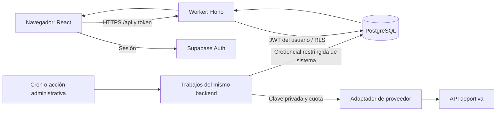

# Arquitectura técnica

Estado: propuesta seleccionada para iniciar, sujeta a la prueba de viabilidad de P02/P10. No es infraestructura ya desplegada. Las versiones concretas se fijarán con un archivo de bloqueo al instalar, usando versiones estables compatibles y Node.js LTS vigente.

## Tecnologías seleccionadas

| Área | Selección | Motivo y límite |
| --- | --- | --- |
| Lenguaje | TypeScript estricto | Compartir tipos y reglas puras entre herramientas y aplicación |
| Interfaz | React + Vite + React Router | Web responsive; compilación estática y navegación sencilla |
| Estilo | CSS con variables y CSS Modules | Identidad propia, pocas dependencias, componentes accesibles |
| Estado de servidor | TanStack Query | Caché, invalidación y estados de carga; incorporar en P03 |
| Validación | Zod | Contratos de entrada/salida; el servidor vuelve a validar |
| Backend HTTP | Hono en Cloudflare Workers | API TypeScript pequeña, mismo origen que el frontend |
| Datos | PostgreSQL en Supabase | Relaciones, restricciones, transacciones y seguridad por fila |
| Autenticación | Supabase Auth | No desarrollar almacenamiento de contraseñas; método de acceso pendiente D04 |
| Acceso a datos | supabase-js sobre HTTPS + funciones SQL para transacciones | Compatible con Workers, sin pool TCP propio ni ORM inicial |
| Migraciones | SQL versionado + Supabase CLI | Esquema, funciones, permisos y semillas reproducibles |
| Desarrollo local | Vite/Wrangler + Supabase local | PostgreSQL y Auth locales; necesita motor de contenedores compatible |
| Herramientas | Node.js LTS, npm, Git | Un gestor y un archivo de bloqueo; sin monorepo complejo |
| Pruebas | Vitest, Testing Library, Playwright, pruebas SQL/RLS | Lógica, interacción, recorridos reales e integridad |
| Calidad | TypeScript, ESLint, Prettier | Convenciones automatizadas, configuración pequeña |
| Integración continua | GitHub Actions, si se conecta repositorio | Runner Linux estándar dentro de cuota; ejecución local equivalente |
| Tareas periódicas | Un Cron Trigger de Workers + tabla PostgreSQL de trabajos | Trabajos pequeños, reanudables, sin Redis ni servidor permanente |
| Observabilidad | Logs estructurados, métricas de cuota y panel de ingesta | Empezar con las herramientas incluidas, sin servicio de pago adicional |
| Datos deportivos | Adaptador sintético y adaptador API-Basketball candidato | El proveedor solo se activa si supera la auditoría |

React/Vite y Hono tienen rutas documentadas en Workers. Esta elección reduce el coste de servir una web privada estática; el portal público con SEO se revisará si D01 lo incluye. [React en Workers](https://developers.cloudflare.com/workers/framework-guides/web-apps/react/), [Hono en Workers](https://hono.dev/docs/getting-started/cloudflare-workers).

Supabase permite trabajar localmente con CLI y contenedores. En P02 se comprueba la instalación disponible y la licencia aplicable del motor elegido; no se da por instalado Docker ni WSL. Si no es viable, valorar un proyecto Free de desarrollo separado de beta, documentando la dependencia de Internet. [Desarrollo local](https://supabase.com/docs/guides/local-development).

## Forma del sistema

Un repositorio, un backend modular y una base de datos. Los módulos se separan por responsabilidad; no son microservicios ni despliegues independientes.



Las peticiones de usuarios consultan nuestra base, nunca desencadenan consultas al proveedor deportivo. La interfaz presenta la fecha de actualización. Los datos incompletos o provisionales se identifican como tales.

## Límites entre módulos

| Módulo | Responsabilidad | No debe hacer |
| --- | --- | --- |
| identity | Identidad, sesión, perfil, roles técnicos | Asignar puntos o dinero |
| leagues | Ligas, invitaciones, miembros y reglas versionadas | Alterar balances por edición libre |
| sports | Equipos, jugadores, plantillas reales, calendario y estadísticas | Acoplar IDs del proveedor a IDs de fantasy |
| ingestion | Consultar, validar, normalizar, reconciliar y registrar origen | Publicar datos sin habilitación ni pisar correcciones ciegamente |
| rosters | Propiedad y elegibilidad de jugadores fantasy | Confundir plantillas de club real con equipos de managers |
| economy/market | Libro de movimientos, compromisos, ofertas y adjudicación | Confiar en importes o propietario enviados por el navegador |
| lineups | Alineaciones, plazos y fotografía del equipo al cierre | Usar la plantilla actual para puntuar una jornada antigua |
| scoring | Fórmula versionada, cálculo y revisiones | Convertir datos desconocidos en cero |
| standings | Agregación y desempates aprobados | Mantener totales irreconciliables con puntos base |
| operations | Trabajos, auditoría y acciones de soporte | Otorgar acceso administrativo al creador de una liga |

## Autenticación y frontera de confianza

Propuesta inicial: navegador usa Supabase Auth para obtener sesión; envía Bearer token a `/api`. El backend valida firma/emisor/audiencia/caducidad antes de usar la identidad. Pasará el JWT del usuario a la capa de datos, para aplicar RLS. El SDK gestiona renovación; cerrar sesión limpia cachés de datos privados.

La persistencia de sesión se decidirá en P04 documentando el riesgo de XSS si se almacena en el navegador. No introducir una segunda autenticación casera. Si se eligen cookies HttpOnly, implementar el flujo completo de sesión, renovación y protección CSRF antes de cambiar el contrato.

El frontend no escribe directamente en tablas de dinero, pujas, puntos o propiedad. **Ocultar una llamada detrás del Worker no basta:** si una función RPC está disponible al rol authenticated, debe comprobar por sí misma identidad, pertenencia, reglas y plazo, incluso llamada directamente. Denegar DML directo y restringir EXECUTE. La clave de sistema nunca se utiliza para peticiones ordinarias de usuarios.

Supabase documenta las políticas RLS y la seguridad de funciones; se mantendrán en migraciones y se probarán con identidades separadas. [RLS](https://supabase.com/docs/guides/database/postgres/row-level-security), [funciones de base de datos](https://supabase.com/docs/guides/database/functions).

## Contratos de API previstos

Los nombres son un diseño inicial, no endpoints ya existentes. No añadir el endpoint de pujas si D09 escoge otro mecanismo.

| Área | Ejemplos | Condiciones |
| --- | --- | --- |
| Estado | `GET /api/health` | Sin claves, versiones internas ni diagnósticos sensibles |
| Catálogo | `GET /api/players`, `GET /api/players/:id` | Paginación, filtros permitidos, datos habilitados para ese entorno |
| Ligas | `POST /api/leagues`, `POST /api/invitations/accept` | Sesión, límites, token válido y transacción |
| Mi equipo | `GET /api/leagues/:id/roster`, `GET .../wallet` | Miembro autorizado; visibilidad económica según reglas |
| Mercado | `GET .../market`, `POST .../bids` o `POST .../offers` | Regla seleccionada, idempotencia, saldo/plazo en BD |
| Alineación | `PUT .../lineups/:roundId` | Revisión esperada, propiedad, posiciones y bloqueo |
| Resultados | `GET .../rounds/:id`, `GET .../standings` | Estado provisional/final, revisión de datos y fórmula |
| Operación | `POST /api/admin/jobs/:id/retry` | Rol técnico, motivo y registro auditable |

Errores con `code`, mensaje legible y `requestId`; sin stack traces. Usar 401/403 para acceso, 409 para conflictos, 422 para reglas inválidas y 429 para límite. Fechas ISO UTC; cantidades monetarias enteras y unidades explícitas. Cada mutación crítica recibe clave de idempotencia vinculada a actor, operación y hash del contenido: repetirla con otro contenido falla.

## Transacciones y reparto de lógica

TypeScript contiene validación de contratos, adaptadores y cálculos puros. Las funciones SQL ejecutan de forma atómica la adjudicación, traspaso, reserva/liberación de saldo y bloqueo de alineación; verifican otra vez las invariantes. No emular una transacción con varias llamadas HTTP consecutivas.

Para cerrar una operación: bloquear filas afectadas en orden estable, comprobar fecha del servidor y versión de reglas, validar saldo/propiedad/capacidad, registrar movimiento y transferencia, actualizar estado y confirmar todo junto. Si se pierde la respuesta, repetir con la misma clave devuelve el resultado anterior.

Puntuación: calcular por lotes pequeños y publicar una revisión solo cuando esté completa. La clasificación nunca mezcla la mitad de una revisión nueva con la anterior.

## Trabajos y relojes

- Un disparador periódico busca trabajos vencidos; no se promete ejecución exacta al segundo.
- PostgreSQL almacena `scheduled_at`, estado, intentos, `lease_until`, cursor y error sanitizado.
- Reclamar trabajo de forma atómica; lease recuperable tras caída; reintentos limitados con espera creciente y variación aleatoria.
- El cron y el botón administrativo usan el mismo ejecutor e idempotencia.
- Un mercado deja de aceptar operaciones al llegar su plazo según el reloj de BD, aunque el cron adjudique después.
- Las alineaciones conservan el estado válido al cierre; una ejecución tardía no incorpora cambios posteriores.
- Al fallar un trabajo no se encadenan cálculos sobre estadísticas parciales.

## Estructura prevista del código

```text
basket-fantasy/
  AGENTS.md
  README.md
  docs/
  src/
    web/                  # rutas, componentes, estilos, API client
    server/               # Hono, autenticación, casos de uso, jobs
    domain/               # tipos y cálculos puros por módulo
    contracts/            # esquemas Zod compartidos
    adapters/             # Supabase y proveedores deportivos
  supabase/
    migrations/           # tablas, índices, funciones y RLS
    seed.sql              # solo datos sintéticos de desarrollo
  tests/
    unit/
    integration/
    e2e/
    fixtures/             # sintéticos; proveedor solo si se permite
  scripts/                # auditoría, mantenimiento y verificaciones
  .github/workflows/      # cuando se configure CI
  .env.example            # nombres y ejemplos falsos, nunca secretos
```

Crear carpetas cuando exista una entrega que las necesite. No generar módulos vacíos para aparentar avance.

## Qué limita esta elección

Workers Free limita CPU, incluidas tareas cron: se medirán JWT, validación, parseo y cálculo. Los lotes deben caber en los límites con margen. Si no caben, reducirlos y medir; si sigue fallando, documentar una decisión de arquitectura antes de P10. No asumir que un plan gratuito ejecuta procesos largos. [Límites Workers](https://developers.cloudflare.com/workers/platform/limits/).

P02 probará el camino React → Worker → PostgreSQL y una transacción; P10 probará el alojamiento real. Ambas puertas evitan invertir todo el MVP en una combinación inviable. La lógica portable permite cambiar el alojamiento en el futuro; Supabase Auth requeriría una migración específica si se sustituye.
