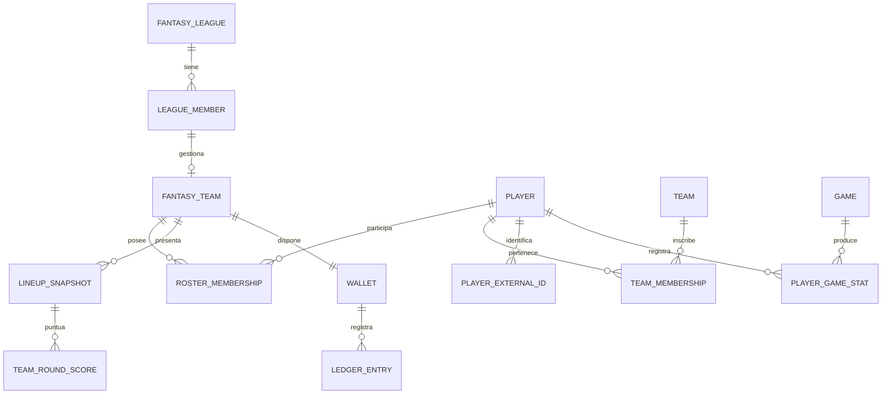

# Modelo de datos e invariantes

Diseño lógico, no migraciones definitivas. Crear tablas por entregas; las dependientes de reglas esperan respuestas. UUID interno para las entidades propias. Las claves externas del proveedor son texto para admitir formatos numéricos y UUID.

## Familias de entidades

| Familia | Tablas previstas | Relaciones y propósito |
| --- | --- | --- |
| Identidad | `profiles`, `platform_roles` | Perfil mínimo enlazado a identidad Auth; rol técnico separado |
| Ligas | `fantasy_leagues`, `league_members`, `league_invitations`, `ruleset_versions` | Una liga usa una versión de reglas; cada miembro tiene rol y estado |
| Universo deportivo | `competitions`, `seasons`, `teams`, `players`, `team_seasons` | Equipos participantes por temporada; jugador independiente de club |
| Identificadores | `player_external_ids`, `team_external_ids`, `game_external_ids`, `competition_external_ids` | Mapas tipados con FK real; unicidad proveedor + ID + ámbito si procede |
| Plantillas reales | `team_memberships` | Jugador/equipo/temporada con intervalo temporal, dorsal y posición de origen |
| Calendario | `games`, `fantasy_rounds`, `round_games` | Jornada fantasy explícita; un aplazamiento no redefine automáticamente su jornada |
| Estadística | `player_game_stats`, `stat_revisions` | Jugador/partido/revisión, proveedor, captura, estado de completitud |
| Equipo fantasy | `fantasy_teams`, `roster_memberships`, `ownership_events` | Manager de una liga; propiedad actual e historial |
| Economía | `wallets`, `ledger_transactions`, `ledger_entries`, `balance_reservations` | Saldos, movimientos y compromisos reconciliables |
| Mercado | `market_cycles`, `market_listings`, `bids`, `trade_offers`, `transfers` | Lote diario, pujas secretas y adjudicación al mayor importe al cierre; listados muestran solo contador; ofertas no son transferencias completadas |
| Alineación | `lineups`, `lineup_slots`, `lineup_snapshots` | Revisión editable y fotografía inmutable al plazo |
| Puntuación | `scoring_runs`, `player_game_scores`, `team_round_scores`, `standings` | Fórmula/revisión de entrada/snapshot; clasificación derivada |
| Operación | `ingestion_runs`, `ingestion_cursors`, `provider_usage`, `jobs`, `idempotency_keys`, `audit_events` | Reanudación, cuotas, trazabilidad y diagnóstico |
| Derechos | `source_permissions`, `asset_permissions` | Evidencia, ámbito, vigencia y recursos cuyo uso se ha autorizado |
| Posterior | `availability_reports`, `player_price_history`, `editorial_links` | Lesiones editoriales, valor propio y noticias; no se implementan por anticipado |

Separar esquemas o permisos para tablas internas. Habilitar RLS en tablas expuestas y denegar acceso por defecto. Las vistas tampoco deben saltarse la protección accidentalmente.

## Relaciones esenciales



## Invariantes obligatorias

1. Un ID de proveedor nunca es PK de una entidad fantasy. Un cambio de proveedor no altera propiedad, dinero ni historial.
2. Un jugador no se fusiona con otro solo por nombre. Mantener coincidencias dudosas en una cola para revisión; cambios de equipo no crean jugadores nuevos.
3. Un usuario no se duplica como miembro de la misma liga. Las relaciones de equipo, oferta, alineación y jornada deben pertenecer a la liga correcta, también mediante claves compuestas donde corresponda.
4. Exclusividad confirmada: índice único parcial sobre liga/jugador para propiedad activa. No hay exclusividad entre ligas; la clave debe incluir siempre la liga.
5. No confiar exclusivamente en comprobaciones previas: las restricciones y bloqueos de BD resuelven dos compras simultáneas del mismo jugador o dos gastos del mismo saldo.
6. Dinero ficticio en unidades enteras (no `float`). Elegir rango seguro; si PostgreSQL usa bigint, serializar como cadena cuando pueda exceder el entero seguro de JavaScript.
7. El saldo proviene del libro de movimientos; la caché de saldo se actualiza en la misma transacción y se reconcilia. Las correcciones se registran como contramovimientos, nunca borrando filas.
8. Saldo disponible = saldo contable menos compromisos activos, si se elige reserva de pujas. La alternativa sin reservas exige reglas de prioridad al adjudicar; no se mezclan ambas implícitamente. La decisión de reservar sigue pendiente D10.
9. Una puja activa es única por manager y listado. Actualizar la propia puja conserva una sola fila; cancelar o retirar deja de contar. El contador publicado es el número de pujas activas distintas, incluida la propia. El cierre diario ignora pujas canceladas o recibidas tarde según hora de la BD.
10. Libro de movimientos con contrapartida: compras entre managers, cuenta del sistema, reparto inicial y premios ficticios. Suma cero por transacción; restricciones diferidas o función atómica que lo garantice.
11. Repetir una adjudicación, transferencia o abono no duplica efectos. Claves únicas de operación y cambios de estado atómicos.
12. Alineaciones históricas no dependen de propiedad actual. Conservar jugador, posición elegible, reglas y plazo aplicados en el snapshot.
13. Reglas, estadísticas y puntuaciones están versionadas. Cambiar una fórmula crea otra versión; una corrección estadística crea otra revisión.
14. Datos ausentes son `null` más motivo/estado, no cero. Diferenciar no jugó, no convocado, partido sin estadísticas y cero real.
15. Puntos con decimal exacto o entero escalado; precisión y redondeo definidos en D14. La suma y clasificación usan el mismo criterio.
16. Fechas en UTC mediante `timestamptz`; mostrar Europe/Madrid en UI. Verificar cambios de horario; no comparar cadenas de hora local.
17. No borrar en cascada historia económica/deportiva al abandonar una liga o borrar una cuenta. Definir conservación y anonimización del identificador visible.

## Estadística deportiva mínima candidata

Por jugador y partido: tiempo jugado en segundos, puntos, rebotes ofensivos/defensivos/totales, asistencias, robos, tapones, pérdidas, faltas y tiros convertidos/intentados (dos, tres, libres), si el proveedor los entrega. Titularidad, faltas recibidas y tapones recibidos solo si se verifican.

Cada registro llevará origen, hora de consulta, estado del partido, versión de normalización, revisión y campos disponibles. Guardar el valor original relevante cuando se permita y sea útil para explicar conversiones. Validar coherencia sin rechazar casos legítimos como rebotes de equipo que no coinciden con la suma individual.

No inferir que se puede replicar la valoración ACB si faltan términos de su fórmula. Los nombres de posiciones se normalizan en una tabla de correspondencias versionada; un cambio posterior no invalida retrospectivamente una alineación.

## Ingesta y publicación

```text
Consultar cuota → obtener lote → validar estructura → resolver IDs
→ guardar/revisar normalizados → detectar anomalías → completar lote
→ habilitar revisión para puntuación → calcular → publicar revisión completa
```

Los datos brutos solo se conservan si los términos lo permiten, con caducidad definida. Si no se pueden conservar, registrar metadatos y hashes sin sustituir evidencia necesaria por una afirmación de calidad. Una respuesta vacía no borra la plantilla entera ni elimina el histórico.

Una revisión anómala queda en cuarentena; la UI sigue mostrando la última revisión válida con su antigüedad. No mezclar en una misma puntuación estadísticas parcialmente corregidas.

## Migraciones y consultas

- Una migración por cambio coherente, probada desde una BD vacía y desde la versión anterior.
- Incluir FK, `NOT NULL` cuando corresponda, `CHECK`, unicidad, índices por filtros y políticas RLS.
- Índices iniciales por liga/miembro, jugador/temporada, partido/estado, trabajo/fecha y listados activos; medir antes de añadir más.
- Paginación obligatoria en catálogo, movimientos y auditoría; límites máximos de página en servidor.
- No almacenar imágenes ni payloads ilimitados en PostgreSQL; vigilar tamaño por tabla.
- Exportación estándar y prueba de restauración antes de beta; el esquema versionado no reemplaza una copia de los datos.
